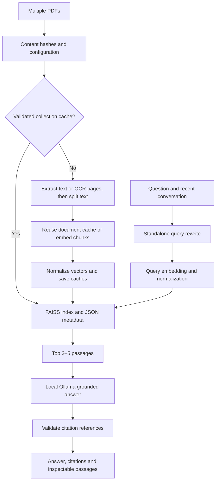

# Mini RAG — Chat with PDFs

A local Python 3.13 application for studying several PDF documents in one conversation. Upload lecture notes, ask a question, and inspect the original passages and page references behind the answer. The Streamlit interface and optional terminal interface share one tested pipeline.

## Quick start (Windows PowerShell)

Install [Ollama for Windows](https://ollama.com/download/windows), then download both local models:

```powershell
ollama pull qwen3:0.6b
ollama pull nomic-embed-text
```

Keep Ollama running. If its desktop app is not running, start `ollama serve` in another terminal. Model downloads need internet access; after download, embeddings and answers run locally. The answer model download is about 523 MB; available RAM and GPU determine speed.

From the project directory:

```powershell
# Only needed if .venv does not already exist:
py -3.13 -m venv .venv

.\.venv\Scripts\Activate.ps1
python -m pip install -r requirements.txt

# Optional: customize the local models and server address:
if (-not (Test-Path .env)) { Copy-Item .env.example .env }
# Defaults work without an API key. See .env.example for OLLAMA_* settings.

python -m streamlit run app.py
```

If PowerShell blocks activation, use `.\.venv\Scripts\python.exe -m streamlit run app.py` directly. Open the local URL printed by Streamlit (usually http://localhost:8501). The optional `.env` file is ignored by Git. An existing environment variable takes precedence over `.env`.

## Using the app

1. Upload several PDFs in the sidebar, or select **Use included document.pdf** for a demonstration.
2. Optionally change chunk size, overlap, and number of retrieved passages. Click **Build document library**.
3. Check document names, page totals, indexed chunks, and warnings. Scanned pages automatically use local CPU OCR. A first build can take longer; the progress bar shows the current page. Password protected or unreadable documents are skipped.
4. Choose a suggested starter question or ask your own, then try a follow-up such as “What are its advantages?”
5. Expand **Search query** to see how the question was rewritten. Expand **Retrieved passages** to inspect filenames, original page numbers, exact text, and similarity scores.
6. **Clear chat** clears the conversation while keeping the library. Removing/uploading files or changing chunking settings resets the active library and conversation; click Build again. Uploaded files are held for the session. To reuse a disk cache after a restart, select the same PDFs and click Build again.

The interface does not automatically index on every rerun. Existing document embeddings are reused when a collection changes, even if a file is renamed. Identical file contents are indexed once; the first selected filename represents duplicates. Distinct documents may have the same filename, so use distinct names for clearer citations.

## Architecture



### Explaining it to your supervisor

The app first reads each PDF page separately so it remembers where every passage came from. If a page has no text layer, PDFium renders it and RapidOCR recognizes text locally on the CPU. Its small OCR models are bundled with the Python package; no cloud OCR service or GPU is used. Original page numbers are preserved. Blank pages are skipped, and failed pages do not prevent other pages from being indexed. OCR text and page counts are cached with the document embeddings. It splits the text into small overlapping chunks: by default, 500 characters with 100 characters repeated between neighboring chunks. Overlap helps preserve meaning near boundaries.

An **embedding** converts a passage into a list of numbers representing its meaning. Ollama embeds document chunks and questions with `nomic-embed-text`, using its `search_document: ` and `search_query: ` prefixes respectively. This model returns 768-dimensional embeddings, which are validated and converted to NumPy float32 arrays. FAISS normalizes each vector to length one and stores it in `IndexFlatIP`. The inner product between normalized vectors is cosine similarity, so larger values indicate a closer semantic match. Similarity is not a probability that an answer is correct.

For a follow-up such as “How does it work?”, The local answer model uses up to six recent messages to rewrite it as “How does MapReduce work?”. The rewritten question is embedded and used for search. If rewriting fails, the original question is used. Conversation history helps interpret references; it is never supplied as factual evidence to answer generation.

The most relevant passages, their filenames, and their original one-based PDF page numbers are sent to the local `qwen3:0.6b` model through Ollama. A separate system instruction restricts the answer to these passages and treats PDF content as untrusted data. The answer must use citations such as `[Source: lecture.pdf, Page 3]`. Answers with missing, malformed, or unretrieved citations are replaced by an unsupported-information message. Retrieved passages and actually cited references are displayed separately.

Citation validation checks that the referenced page was retrieved. It cannot prove that every claim logically follows from that page. Always inspect the passages for important conclusions. A model can still make mistakes or be influenced by malicious content despite prompt defenses.

## Persistence and configuration

- `cache/documents/<hash>/` stores reusable single-document embeddings.
- `cache/collections/<hash>/` stores assembled multi-document indexes.
- Each folder contains `index.faiss` and `metadata.json`; no Pickle is read. Legacy root-level index, JSON, Pickle, and original PDFs are preserved and unused because their provenance/configuration is not fully validated.
- SHA-256 content hashes and configuration form stable cache identifiers. File order does not change a collection key. Content, chunk settings, embedding model, dimension, extractor version, or schema changes invalidate the relevant cache. Changing the answer model does not require new embeddings.
- Loads validate the index checksum, dimensions, normalized finite vectors, chunk count, page ranges, document statistics, and metadata. Missing/damaged collections are rebuilt from valid document caches. Writes use unique temporary files and atomic replacements; inconsistent pairs are rejected on the next load.
- Treat the cache folder as trusted local data. Checksums detect accidental corruption; they are not authentication against someone who can replace both files. PDF text is saved in JSON on disk. Do not share private caches.
- Defaults live in `rag/config.py`. Set `OLLAMA_MODEL`, `OLLAMA_EMBEDDING_MODEL`, and `OLLAMA_BASE_URL` in `.env` or your environment to override them. If changing the embedding model, also update `Settings.dimension` to match its output. The UI exposes chunk size, overlap, and top-k. Index generation is batched in groups of 32 chunks. At most three application attempts are made for transient network errors or HTTP 429/500/502/503/504 with 1- and 2-second delays. Requests have a 300-second timeout to allow model loading and CPU inference. HTTP proxy environment variables are ignored for these local requests.

## Technology and project layout

Python 3.13; Streamlit; Ollama with `nomic-embed-text` and `qwen3:0.6b`; FAISS CPU; PyPDF; pypdfium2; RapidOCR with CPU ONNX Runtime; LangChain RecursiveCharacterTextSplitter; NumPy; python-dotenv; httpx.

```text
app.py                    Streamlit UI and session chat state
main.py                   Optional terminal conversation
rag/config.py             Defaults and cache schema
rag/pdf_processor.py      Native text/OCR extraction and chunk metadata
rag/ocr.py                Bounded page rendering and local CPU OCR
rag/embeddings.py         Ollama HTTP access, validation and safe retries
rag/vector_store.py       Deduplication, persistence and validation
rag/retriever.py          Normalized cosine-equivalent FAISS search
rag/generator.py          Query rewriting, grounded answers and citations
tests/                    Automated offline tests and Streamlit AppTest
cache/                    Generated indexes and JSON (ignored by Git)
check_models.py            Explicit model-listing diagnostic
test_local.py             Explicit local model smoke check
```

## Testing and terminal interface

```powershell
python -m pip install -r requirements-dev.txt
python -m pytest tests -q
python -m compileall -q app.py main.py rag tests
python -m pip check

# Explicit local requests (requires Ollama and downloaded models):
python test_local.py
python check_models.py

# Optional terminal chat, /clear and /quit:
python main.py document.pdf
python main.py lecture1.pdf lecture2.pdf
```

Offline tests exercise actual PDF extraction, real CPU OCR of an image-only PDF, original page references, real FAISS operations, cache reuse/invalidation/corruption, multi-document metadata, query rewriting, citation filtering, retries, local configuration, chat history, and UI state changes. They mock the local Ollama service and do not require model downloads or a running server. `test_local.py` is guarded so importing it during test discovery never sends requests.

## Limitations and future improvements

- Scanned pages use local CPU OCR automatically. Recognition can be imperfect for blurry, rotated, handwritten, non-English, or complex table content; inspect retrieved passages before trusting an answer. Password protected PDFs must be unlocked first. PDF page numbers may differ from printed slide numbers.
- The interface, vector database, embeddings, question rewriting, and answers run locally with the default `http://localhost:11434` server and downloaded models. If you configure a remote Ollama address, document text and questions are sent to that address. There is no API key or paid API quota.
- Chat history is session-only. Disk caches persist, but are not an upload manager or a permanent chat archive.
- Retrieval returns a small number of nearest chunks; questions requiring many distant pages may miss evidence. There is no calibrated relevance threshold, reranker, or guarantee of semantic entailment.
- Very large documents require memory and local inference time. Concurrent first-time builds in separate sessions may duplicate requests; the app is intended for local single-user study. Completed document caches prevent repeated work across normal reruns and restarts; an interrupted document embedding batch may be requested again.
- Future improvements: hybrid keyword/vector retrieval, reranking, claim-level verification, streaming responses, persistent chat export, and cache management controls.

API usage follows Ollama's [embedding documentation](https://docs.ollama.com/api/embed) and [chat documentation](https://docs.ollama.com/api/chat).
